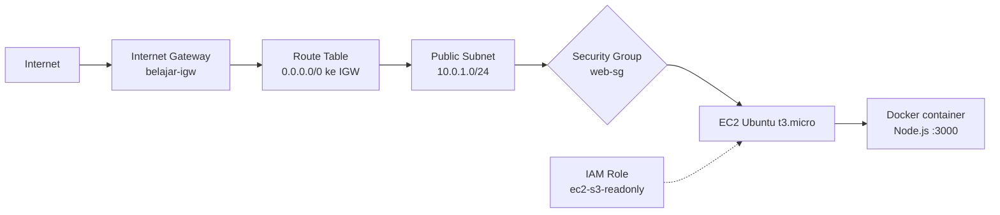

# Deploy Aplikasi Docker di AWS EC2 (Setup Manual)

Proyek belajar membangun jalur jaringan dari internet sampai ke container Docker di AWS **secara manual lewat console**, sebelum diotomatisasi dengan Terraform. Tujuannya memahami kenapa setiap komponen ada, bukan sekadar menjalankannya.

> Status: Minggu 1 dari roadmap DevOps. Lanjutan: provisioning ulang seluruh stack dengan Terraform.

## Arsitektur



Semua resource berada di dalam satu VPC (`10.0.0.0/16`) di region `ap-southeast-1` (Singapore).

## Resource yang dibuat

| Resource | Konfigurasi | Fungsi |
|---|---|---|
| VPC | `belajar-vpc`, `10.0.0.0/16` | Jaringan privat milik sendiri di AWS |
| Subnet | `public-subnet-1`, `10.0.1.0/24`, AZ `ap-southeast-1a`, auto-assign public IP | Segmen jaringan tempat EC2 berada |
| Internet Gateway | `belajar-igw`, attached ke VPC | Pintu keluar-masuk ke internet |
| Route table | `0.0.0.0/0` menuju IGW, diasosiasikan ke subnet | Menentukan arah traffic; subnet menjadi "public" karena route ini |
| Security group | `web-sg`: SSH 22 dari IP sendiri, HTTP 80 dari `0.0.0.0/0` | Firewall di level instance |
| IAM role | `ec2-s3-readonly` (`AmazonS3ReadOnlyAccess`) | Izin ke layanan AWS tanpa menyimpan access key di server |
| EC2 | Ubuntu LTS, `t3.micro`, IMDSv2 required | Server tempat Docker berjalan |

## Langkah singkat

1. **Keamanan akun**: MFA di root, buat IAM user untuk kerja harian, pasang budget alert.
2. **Networking**: VPC, subnet, internet gateway, route table, lalu hubungkan subnet ke route table.
3. **Akses**: security group dan IAM role.
4. **Compute**: launch EC2 di subnet publik dengan key pair dan instance profile.
5. **Docker**: install Docker Engine dari repository resmi.
6. **Deploy**: build image dan jalankan container.

### Install Docker (Ubuntu)

```bash
sudo apt update && sudo apt install -y ca-certificates curl
sudo install -m 0755 -d /etc/apt/keyrings
sudo curl -fsSL https://download.docker.com/linux/ubuntu/gpg -o /etc/apt/keyrings/docker.asc
echo "deb [arch=$(dpkg --print-architecture) signed-by=/etc/apt/keyrings/docker.asc] https://download.docker.com/linux/ubuntu $(. /etc/os-release && echo "${UBUNTU_CODENAME:-$VERSION_CODENAME}") stable" | sudo tee /etc/apt/sources.list.d/docker.list > /dev/null
sudo apt update
sudo apt install -y docker-ce docker-ce-cli containerd.io docker-buildx-plugin docker-compose-plugin
sudo usermod -aG docker ubuntu && newgrp docker
```

### Aplikasi dan Dockerfile

`index.js`:

```js
const http = require('http');
const os = require('os');

http.createServer((req, res) => {
  res.setHeader('Content-Type', 'application/json');
  res.end(JSON.stringify({
    message: 'Halo dari Docker di EC2!',
    hostname: os.hostname(),
    time: new Date().toISOString()
  }));
}).listen(3000, () => console.log('Server jalan di port 3000'));
```

`Dockerfile`:

```dockerfile
FROM node:20-alpine
WORKDIR /app
COPY index.js .
EXPOSE 3000
CMD ["node", "index.js"]
```

### Build dan jalankan

```bash
docker build -t myapp .
docker run -d --name myapp --restart unless-stopped -p 80:3000 myapp
```

Port `80:3000` meneruskan port 80 server ke port 3000 di container. Opsi `--restart unless-stopped` membuat container hidup lagi otomatis setelah server direstart (sudah diuji dengan `sudo reboot`).

## Hasil verifikasi

- Akses `http://<public-ip>` mengembalikan JSON dari aplikasi, dengan `hostname` yang sama dengan ID container di `docker ps`.
- Setelah `sudo reboot`, container yang sama (ID tidak berubah) hidup kembali tanpa intervensi.

## Troubleshooting: masalah yang ditemui

### Diagnosis cepat: timeout vs refused

| Gejala | Artinya | Cek di |
|---|---|---|
| **Timeout** (lama, lalu gagal) | Paket di-drop sebelum sampai | Security group, route table, IGW, IP sumber |
| **Connection refused** (langsung gagal) | Paket sampai, tapi tidak ada proses yang mendengarkan | Container mati, port salah |
| **Permission denied** | Jaringan lolos, gagal di autentikasi | Key, username, izin file |

Perbedaan ini dibuktikan sendiri dengan menghapus rule HTTP dari `web-sg` (hasilnya timeout), lalu menjalankan `docker stop` (hasilnya refused).

### Kasus nyata

1. **SSH timeout padahal semua konfigurasi benar.**
   - Penyebab pertama: IP publik berganti-ganti antar beberapa alamat, sehingga rule SSH yang hanya mengizinkan satu `/32` sesekali gagal. Dipastikan dengan menjalankan `curl ifconfig.me` berulang kali.
   - Penyebab kedua: jaringan WiFi memblokir port 22 keluar. Dipastikan dengan `Test-NetConnection github.com -Port 22` (ping berhasil, TCP gagal). Solusi: pindah ke hotspot, atau gunakan Session Manager tanpa port 22.
2. **`UNPROTECTED PRIVATE KEY FILE`.** File `.pem` bisa dibaca grup *Everyone*. Diperbaiki dengan `icacls` agar hanya user sendiri yang punya akses baca.
3. **Halaman lama masih tampil setelah ganti container.** Ternyata cache browser. Dipastikan dengan `curl localhost` di server dan mode Incognito.
4. **Salah ketik IP di browser** (kurang satu digit) menghasilkan timeout. Pelajarannya: bandingkan IP di console dengan yang diketik sebelum menyimpulkan ada masalah infrastruktur.
5. **Rule security group tertukar** (SSH terbuka ke `0.0.0.0/0`, HTTP dibatasi). Selalu cek ulang kolom Source per rule sebelum menyimpan.

## Pengendalian biaya

- Budget alert dipasang sejak hari pertama.
- Hindari layanan yang berjalan terus dan boros kredit (NAT Gateway, load balancer, control plane EKS) saat belajar.
- Instance di-**stop** setelah latihan, lalu di-**terminate** setelah dokumentasi selesai.
- Public IP berubah setiap stop/start; Elastic IP sengaja tidak dipakai untuk menghindari biaya sisa.

## Catatan keamanan

- Root user hanya untuk keperluan darurat; harian memakai IAM user dengan MFA.
- SSH hanya dibuka untuk IP sendiri, bukan `0.0.0.0/0`.
- IAM role dipakai untuk akses ke layanan AWS, tanpa access key di server.
- File `.pem` tidak boleh masuk repo (`*.pem` ada di `.gitignore`).


